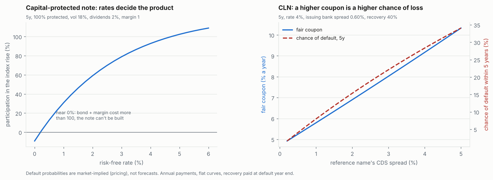

# Credit Pricer
[](https://github.com/ohunter-dev/credit/actions/workflows/ci.yml)

A small Python library that prices the building blocks of credit structuring, from a plain bond up to a credit-linked note (CLN). I built it in four stages, checking each against hand-worked numbers before moving on: bonds and the capital-protected note, default risk, credit default swaps, then the CLN.

My [autocall pricer](https://github.com/ohunter-dev/autocall) covered the equity side of structuring. This is the other half: rates and credit, and the issuing bank's own credit risk, which the autocall left out.



## What I found

`python -m credit.run` prints every number below.

**1. A capital-protected note is a bond plus calls, and rates decide whether it works.** Out of the client's 100, the bank buys a zero-coupon bond that grows into 100 (the guarantee), keeps a margin, and spends the rest on calls. At 4% rates the bond costs 81.9, leaving 17.1 for options: about 93% participation in the index rise. At 0.5% the bond costs 97.5 and participation drops to 13%. That's why these notes nearly disappeared when rates were near zero and autocalls replaced them: an autocall is funded by the client selling a put, not by interest.

**2. "Capital protected" means protected by the issuer.** The bank discounts the bond leg at its own borrowing rate, so a weaker bank (a 1% funding spread) can offer 114% participation instead of 93%. The extra is the client being paid to take that bank's default risk.

**3. A credit spread is an expected loss.** `spread ≈ default rate × (1 − recovery)`. A 1.2% spread with 40% recovery prices about a 2% default rate a year. Default probabilities compound rather than add, because a name can only default once: 16.7% a year is a 56.5% chance over 5 years, not 83%. These are market-implied pricing numbers, not forecasts; spreads carry a risk premium, so they usually sit above historical default rates.

**4. A CDS has the same shape as everything else.** The premium is paid only while the name survives (weighted by survival); the protection pays once, in the year default happens. The par spread is `protection ÷ risky annuity`: 1.21% here, against 1.20% from the credit triangle shortcut. That's the same shape as the autocall's fair coupon `(1 − A) / B`. The CS01 on 10m is about 4,200 per basis point.

**5. A CLN coupon is three things added up.** The client buys the bank's note and, inside it, sells protection on a reference name:

| Piece | Here | The client is paid for |
|---|---|---|
| Risk-free rate | 4.00% | lending cash |
| Issuing bank's spread | 0.60% | lending to the bank |
| Reference CDS spread | 1.20% | insuring the reference name |
| Fair coupon | 6.01% | (5.80% added up; the gap is compounding) |

If the reference name defaults, the note stops, coupons stop and the client gets the recovery, about 40 per 100.

**6. Wrong-way risk is the trap.** The pricing treats the bank and the reference name as separate risks. If a bank issues a CLN on its own sovereign, they're not: the bank holds its government's bonds and relies on state support, so in the scenario where the client loses 60 on the sovereign, the bank owing them the recovery may be failing too. The coupon looks like pay for two risks; it's really one concentrated risk with a much worse worst case. An issuer unrelated to the reference name avoids it.

## Run it

```
python -m venv .venv
.venv\Scripts\activate          # Windows; on Mac/Linux: source .venv/bin/activate
pip install -r requirements.txt

python -m credit.run            # all four stages, end to end
python -m credit.plots          # the figure -> docs/
pytest -q                       # 12 tests
```

## Modules

| File | What it does |
|---|---|
| `credit/bonds.py` | Discounting, zero and coupon bonds, the capital-protected note |
| `credit/default.py` | Survival, default probability, the credit triangle, a risky zero |
| `credit/cds.py` | Risky annuity, premium and protection legs, par spread, CS01 |
| `credit/cln.py` | The CLN's three legs and its fair coupon |
| `credit/run.py` | Prints everything above |
| `credit/plots.py` | The two-panel figure |

The tests check each piece against numbers worked out by hand, plus the shapes that must hold: the par spread balances the two legs, the CLN prices to exactly 100 at its fair coupon, and a riskier reference name always pays more.

## Limitations

- **Flat curves.** One rate and one default rate for every maturity. Real desks build both curves from market quotes at several tenors.
- **Annual payments, default only at year ends,** and recovery paid at the end of the default year. Real CDS pay quarterly and settle recovery through an auction.
- **Recovery is an assumption (40%).** The same spread with a lower recovery implies fewer, but worse, defaults.
- **Issuer and reference are treated as independent.** That's exactly the assumption that breaks under wrong-way risk (point 6).
- **The issuer's credit is a discounting shortcut** (rate + spread), not a full joint default model.
- **Implied probabilities are for pricing,** not forecasts, and shouldn't be shown to clients as the chance of being repaid.
